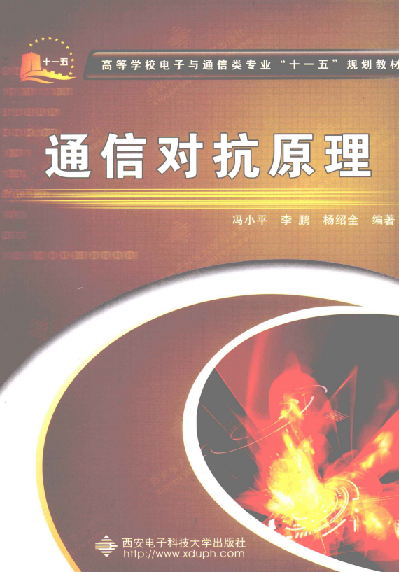
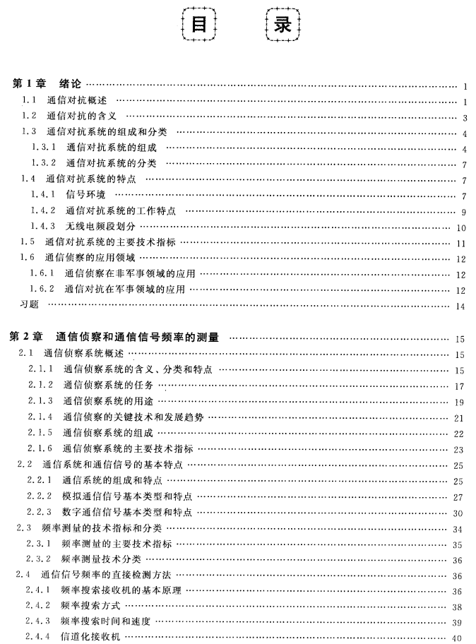
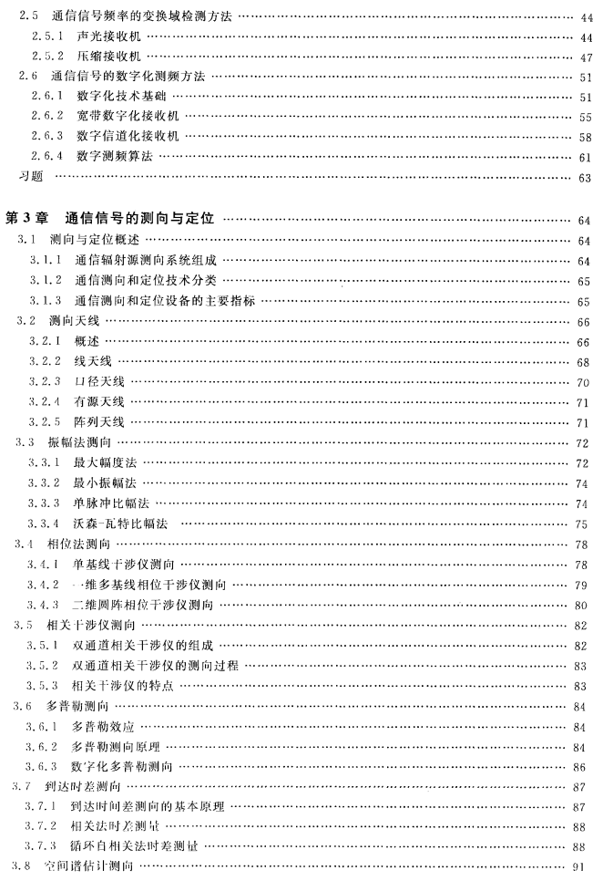
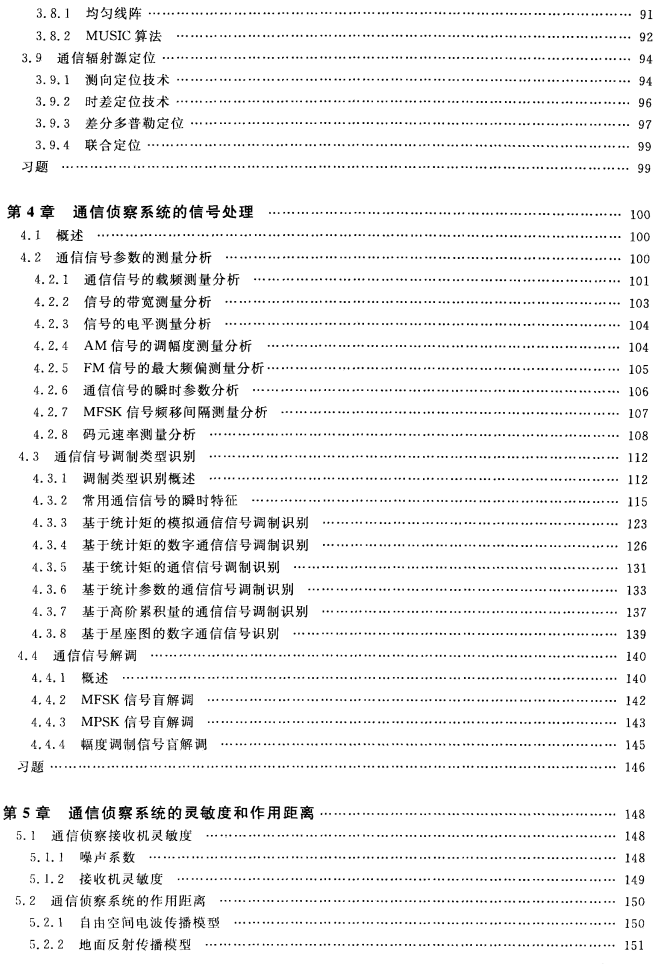
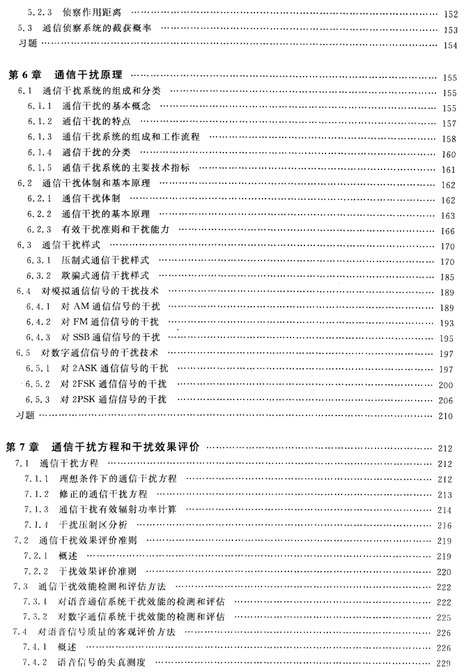
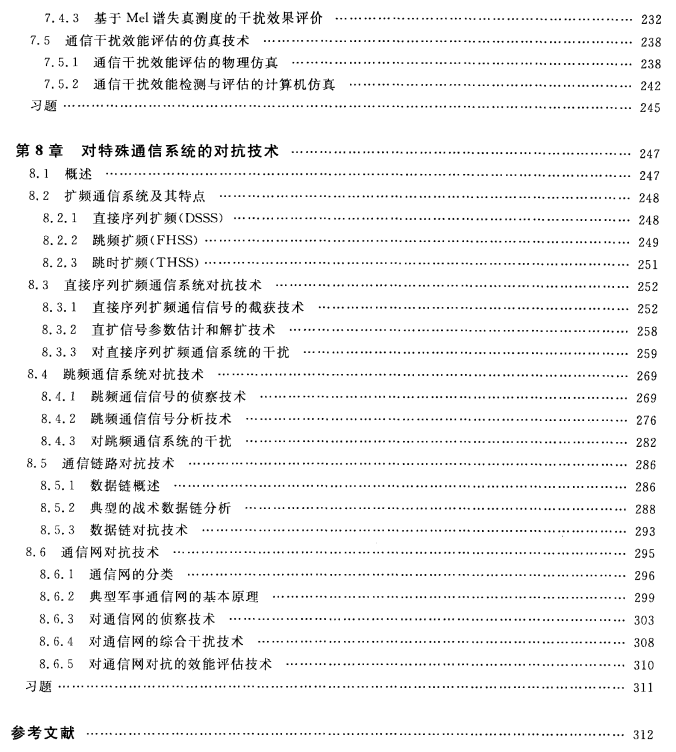

# Recommended Textbook | "Principles of Communication Combat": Unveiling the "Electromagnetic Game" in the Information Battlefield

This book, co-authored by Feng Xiaoping, Li Peng, and Yang Shaoquan, was published by Xi'an University of Electronic Technology in 2009. It is a "11th Five-Year Plan" textbook for electronics and communication majors in higher education institutions. The ISBN is 978-7-5606-2320-7, priced at 29 yuan. As the core textbook for information countermeasure technology, it is suitable for both undergraduate and graduate students to systematically learn from, providing authoritative references for technical personnel in the field of communication countermeasures. Additionally, the publisher offers free electronic teaching materials for teachers.
The book focuses on the core principles and technologies of communication countermeasure systems, focusing on four core tasks: interception, positioning, processing, and interference. It covers topics such as frequency measurement of communication signals, directional measurement and positioning technology, signal processing methods for communication reconnaissance, interference principles in analog and digital communication systems, and countermeasure techniques for special systems like spread spectrum communication, data links, and communication networks. It comprehensively presents the theoretical framework and technical details of the field of communication countermeasures.
The textbook consists of 8 chapters, with a clear structure and progressive progression. Chapter 1 outlines the concept of communication countermeasures, system components, classifications, and characteristics, tracing its development from the Russo-Japanese War to modern times, revealing its essence of "struggling for control over the electromagnetic spectrum." Chapters 2-5 focus on communication reconnaissance technology, detailing frequency measurement methods (direct detection, transform domain detection, digital frequency measurement, etc.), ranging and positioning techniques (amplitude comparison method, phase interference method, Doppler method, etc.), as well as signal parameter analysis, modulation recognition, and demodulation technology. It also explores the sensitivity of reconnaissance systems and the calculation of operational distance.
Chapters 6-7 delve into the principles of communication interference, introducing the composition, classification, and key technical indicators of interference systems. They analyze suppression and deception interference styles, as well as methods for jamming AM, FM, and other analog signals and ASK, PSK, FSK, and other digital signals. The chapter also discusses interference equations and evaluation criteria for effectiveness. Chapter 8 specifically covers special communications system countermeasures, including interception and jamming of direct sequence spread spectrum and frequency hop spread spectrum, reconnaissance and jamming techniques for data links and communication networks, keeping up with technological frontiers.
The book's distinctive feature lies in its integration of theory and practice: it systematically reviews the foundational principles of communication countermeasures while incorporating recent research findings, reflecting the digitalization and software-based trends in signal processing. It balances classic methods with emerging technologies, covering both traditional frequency measurement and direction determination techniques as well as modern approaches such as spatial spectrum estimation and higher-order cumulants. As a compulsory course, it precedes courses like Electronic Circuits and Communication Principles, which can be followed by courses on Information Warfare Theory, etc. The teacher can choose to teach based on teaching needs.
Whether you are a student specializing in information warfare or a researcher in electronic warfare and communication security, this book can help you build a knowledge system of communication countermeasures and grasp the technical core of electromagnetic battlefield. It is an essential bible for the field of communication countermeasures.
End

## Images

<!-- PAYMENT_BLOCK -->

## Get this dataset

- Payment link (Stripe): [Buy now](https://buy.stripe.com/3cs8yP7sY87d0vu9AB)
- Payment QR code: 

<!-- /PAYMENT_BLOCK -->
